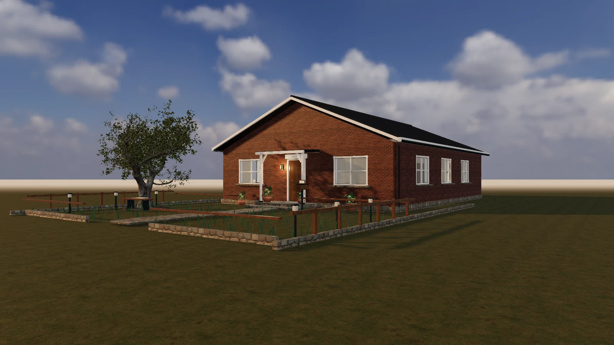
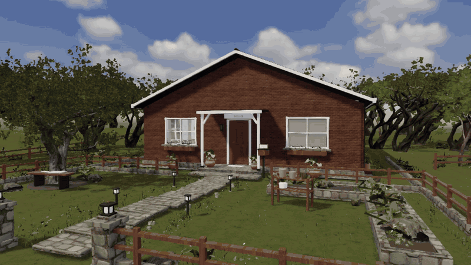

# Paper Home

> An open-source, walkable 3D digital cottage and personal homepage template — launch with a double-click, edit your projects and notes visually in the browser without touching code, and publish anywhere for free.

<p align="center">
  <a href="./LICENSE"></a>
  <a href="https://github.com/lyu24944-cmyk/paper-home/actions/workflows/ci.yml"></a>
  <a href="https://nodejs.org/"></a>
</p>

<p align="center">
  <a href="./README.zh-CN.md">简体中文</a> · <strong>English</strong> · <a href="#-open-your-cottage-in-3-zero-code-steps">Zero-Code Quickstart</a> · <a href="#-no-coding-experience-copy-these-ai-prompts">AI Prompts</a> · <a href="#%EF%B8%8F-developer-reference">Developer Reference</a>
</p>

<p align="center">
  
</p>

<p align="center">
  
</p>

---

## ✨ What Is Paper Home?

Instead of a static link-in-bio page or a floating 3D gimmick, Paper Home gives you a **real, walkable 11×15 m single-storey cottage** built with React 19, Three.js, and Vite:

- **Walkable Architecture & 6mm Glass**: Look straight through the courtyard windows into the corridor, study desk, and gallery frames, then open the door and walk through **Study Notes**, **Gallery**, and **About Me**.
- **Living Time-of-Day & Rain Soundscapes**: Switch between **Dawn**, **Daylight**, **Sunset**, **Night**, **Auto**, and **Rain** in the top bar. Enable ambient audio for synthesized WebAudio wind chimes and filtered rain that muffles realistically when you step indoors.
- **Tactile Room Objects**: Switch on the green-shaded brass desk lamp, draw a random quote slip from the bookshelf, sit on the yard bench, stamp the wooden guestbox, or capture a paper postcard with a shareable deep link.
- **Zero-Code Visual Editing**: Create projects, upload images and videos, write notes, and rename your cottage directly inside the browser.
- **Mobile & In-App Browser Friendly**: Automatically switches to lightweight `1024×1024` `-1k.webp` textures and low-poly plant models on phones, tablets, `<= 4 GB` memory devices, and built-in WebViews (WeChat, Xiaohongshu, Douyin, Bilibili, Weibo, QQ), plus graceful WebGL context-loss recovery.

---

## 🚀 Open Your Cottage in 3 Zero-Code Steps

### Step 1: Install Node.js (One-Time Setup)

1. Visit [https://nodejs.org/](https://nodejs.org/).
2. Download the **LTS (Long Term Support)** installer (**Node.js 20 or higher**).
3. Run the installer and click **Next / Install** until finished.

> **Troubleshooting**:
> - If you had an older Node.js version installed, simply install the latest LTS over it.

---

### Step 2: Download and Unzip This Project

1. Click the green **`<> Code`** button near the top of this GitHub page.
2. Click **`Download ZIP`**.
3. **Extract / Unzip the downloaded `.zip` archive** into a normal folder (e.g., on your Desktop or Documents).

> **Troubleshooting**:
> - **Do not launch directly inside a ZIP preview window** — always extract the full folder first.

---

### Step 3: Double-Click the Launcher

Inside the extracted folder:

- **Windows**: Double-click **`启动小屋.bat`**
- **macOS**: Double-click **`启动小屋.command`**

On first launch, it automatically installs dependencies, imports starter sample content so the cottage isn't empty, and opens `http://127.0.0.1:4318/` in your browser.

> **Troubleshooting**:
> - **macOS blocks `启动小屋.command` ("unidentified developer")**: Right-click (or Control-click) `启动小屋.command` → **Open** → click **Open** in the dialog (only needed once), or allow it under **System Settings → Privacy & Security → Open Anyway**.
> - **Windows SmartScreen warning**: Click **More info** → **Run anyway**.
> - **Keep the terminal window open while using the cottage**; close that window when you are done.

---

## ✍️ Customizing Your Content (All in the Browser)

1. Click **Cottage Map (`小屋地图`)** in the top-right corner and choose **Enter Edit Mode (`进入编辑模式`)** (local editing is restricted to `127.0.0.1` / `localhost`).
2. **Branding & Default Atmosphere**: Rename your cottage, customize the wooden plaque & yard greeting, and choose the default time-of-day and weather visitors see first.
3. **Edit Each Room**:
   - **Gallery**: Add projects with cover images, photo galleries (auto-compressed to WebP), and MP4/WebM demo videos. Your top 3 published projects appear framed on the 3D gallery wall.
   - **Study**: Write long-form notes with images, videos, and project links.
   - **About Me**: Update your bio, avatar, contact links, 3 tabletop **Now Notes**, and bookshelf quote slips.
4. **Visitor Preview**: Click **Editing (`编辑中`) → Exit Edit / Visitor Preview** anytime to verify unpublished drafts stay hidden. Everything saves locally inside `local-data/`.

---

## 🤖 No Coding Experience? Copy These AI Prompts

Open the extracted folder in **Antigravity, Cursor, or Trae** and paste any of these prompts directly to your AI assistant:

1. **Launch locally**:
   ```text
   Help me launch this Paper Home project locally: check if Node.js 20+ is installed, run npm install if node_modules is missing, import starter samples with npm run init:sample if local-data is empty, start Local Studio with PAPER_HOME_FORCE_LOCAL=1 npm run studio, and tell me in plain language how to edit content in the browser.
   ```
2. **Replace with my own profile & projects**:
   ```text
   I want to replace Paper Home with my own name, intro, and works without hand-editing code. Make sure Local Studio is running, guide me step by step (or help me load my prepared materials into Local Studio while keeping browser editing intact), and help me verify Visitor Preview has no leaked drafts.
   ```
3. **Publish for free on GitHub Pages**:
   ```text
   I've customized my cottage locally and want to publish it for free on GitHub Pages. Help me verify all items I want visible are published, run npx tsc --noEmit and npm run build:local, test that the static bundle has zero 404 errors under a repository subpath, and walk me through enabling Settings -> Pages (GitHub Actions) and manually triggering Deploy Paper Home to GitHub Pages -> Run workflow.
   ```
4. **Troubleshoot an error**:
   ```text
   I hit this error while running or publishing Paper Home (pasted below). Explain the cause in plain, non-technical language, fix it if it's a config/code issue, and show me how to confirm it's working.
   ```

---

## 📜 License & Asset Attributions

- **Code**: [MIT License](./LICENSE) (`© 2026 lyu24944-cmyk`).
- **3D Textures, Plants & HDRI**: [Poly Haven](https://polyhaven.com/) under **CC0-1.0**, stored locally in `public/assets/realistic/` with **zero external runtime requests**. Full attribution table and checksums are in [ASSETS.md](./ASSETS.md).
- **Handwriting Font**: `HomeHand` subset of [LXGW WenKai TC](https://github.com/lxgw/LxgwWenkaiTC) under SIL Open Font License 1.1 ([OFL.txt](./public/fonts/OFL.txt)).
- **Audio**: Real-time WebAudio synthesis with zero external audio files.

---

## 🛠️ Developer Reference

<details>
<summary>Expand: Commands, Quality System, Subpath Deployment & Optional Cloud CMS (Supabase)</summary>

### Scripts

| Command | Purpose |
| --- | --- |
| `npm run dev` | Start Vite dev server + Local Studio API at `http://127.0.0.1:4318/` |
| `npm run studio` | Start Local Studio and auto-open the browser |
| `npm run init:sample` | Seed neutral starter items into `local-data/` when empty (`--force` resets) |
| `npm run build` | Asset verification + TypeScript build + Vite production build |
| `npm run build:local` | Build a read-only static snapshot in `dist/` (`dist/local-snapshot/`) |
| `npm run preview` | Preview `dist/` locally at `http://127.0.0.1:4319/` |
| `npm run assets:1k` | Generate 18 `1024×1024` `-1k.webp` mobile textures and update `manifest.json` |
| `npm run assets:prepare` | Re-download and process all Poly Haven assets + 1K variants |
| `npm run assets:verify` | Verify SHA-256 checksums of all 41 local assets in `manifest.json` |
| `npm run check:camera` | Verify 75,144 camera trajectory samples across 120 routes & 6 viewports |
| `npm run check:sound` | Playwright verification of WebAudio synthesis & tactile SFX |
| `npm run check:phase1` | Playwright verification of atmospheres, rain & room props |
| `npm run check:phase2` | Playwright verification of paper postcards & deep links |
| `npm run check:local` | Playwright end-to-end verification of Local Studio & static export |
| `npm run check:cms` | Playwright + Mock Supabase verification of Cloud CMS & TUS uploads |
| `npm run check:edge-cases` | Verify retry on asset failure, DPR cap & mobile touch against `:4319/?qa` |
| `npm run promo:capture` | Generate promo screenshots, vertical/horizontal videos & README media |
| `npm run sync:supabase` | Migrate `local-data/` to your Supabase project |

### Mobile Quality & Context Recovery

- **Dual Quality Packs**: `high` loads full 4K/2K `.webp` textures and high-poly GLBs; `low` loads `1024×1024` `-1k.webp` textures (`1.67 MiB` total) and low-poly GLBs. Selection priority: `?quality=` URL param > saved `localStorage` choice > automatic detection (mobile/tablet devices, `deviceMemory <= 4`, and WeChat / Xiaohongshu / Douyin / Bilibili / Weibo / QQ WebViews default to `low`). Switching quality disposes the replaced GPU textures and GLTF geometries cleanly.
- **WebGL Context Loss**: Listens for `webglcontextlost`, presents a styled recovery card with a **Switch to Compatible Quality & Retry** button, and remounts `<Canvas>` cleanly in `low` mode.

### Optional Cloud CMS Mode (Supabase + Cloudflare Pages)

For multi-device online editing with magic-link auth, see [DEPLOY.md](./DEPLOY.md) (in Chinese) and run `npm run sync:supabase` when ready. QA measurements are documented in [QA.md](./QA.md).

</details>
