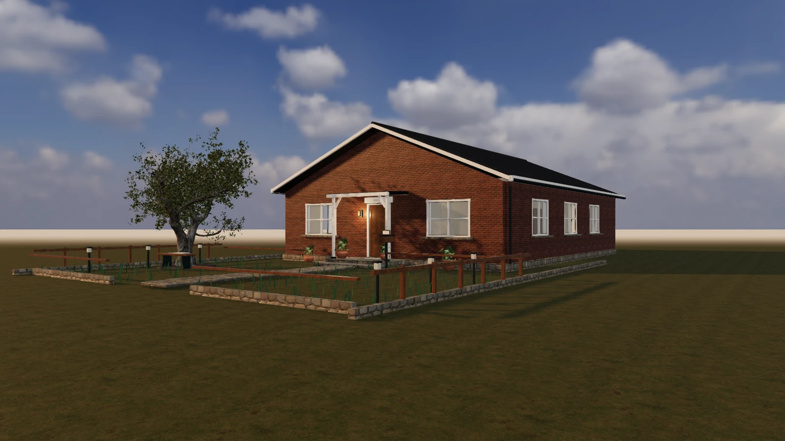
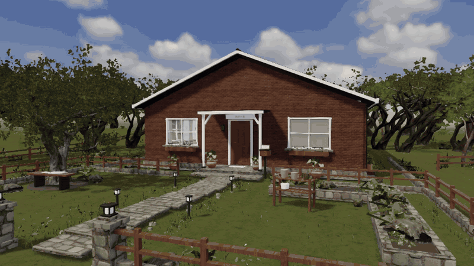

# Paper Home · 我的小屋

> 一座可以推门走进去的三维个人主页与作品集模板 —— 不会写代码也能双击运行，在网页里直接换成自己的文字、图片和视频，免费发布给朋友逛。

<p align="center">
  <a href="https://lyu24944-cmyk.github.io/paper-home/"></a>
  <a href="./LICENSE"></a>
  <a href="https://github.com/lyu24944-cmyk/paper-home/actions/workflows/ci.yml"></a>
  <a href="https://nodejs.org/"></a>
</p>

<p align="center">
  <strong><a href="https://lyu24944-cmyk.github.io/paper-home/">在线逛小屋</a></strong> · <strong>简体中文</strong> · <a href="./README.md">English</a> · <a href="#-零基础-3-步打开你的小屋">零基础启动</a> · <a href="#-不会写代码让-ai-帮你">AI 助手提示词</a> · <a href="#-开发者参考">开发者参考</a>
</p>

<p align="center">
  
</p>

<p align="center">
  
</p>

---

## ✨ 这是什么？

这不是常见的“平面个人简介页”，也不是“只能看不能走进去的 3D 摆件”：

- **真正可以推门逛的 11×15 米独栋小屋**：从庭院走上台阶，推开木门穿过走廊，走进 **「创作手记」「作品室」「关于我」** 三个房间；站在院子里就能透过物理玻璃窗看见屋里的书桌和画架。
- **会呼吸的四时天色与雨声**：顶栏一键切换 **晨雾、晴昼、落日、夜灯、跟随时间** 以及 **细雨**；打开右下角环境声，可以听到实时合成的微风风铃与屋檐雨声（走进室内还会自动变成隔着窗听雨的闷声）。
- **屋里有能点的小物件**：点亮书房的绿罩黄铜台灯、从书架抽一张灵感签、坐上院子老树下的木长椅、在「关于我」木桌上用心情印章盖下访客足迹、随时拍一张带天气氛围的纸质明信片。
- **不用改代码，全部在网页里编辑**：打开后直接点开后台界面写文字、传图片和视频、改小屋名字与迎客语。
- **手机、微信里也能顺畅打开**：内置高/兼容双画质（PC 默认 4K/2K 写实贴图，手机、平板及微信/小红书/抖音/B站/微博/QQ 内置浏览器自动切到 1K 轻量材质），遇到显存紧张还会提示「切换兼容画质并重试」，尽量不黑屏。

---

## 🚀 零基础 3 步打开你的小屋

完全不会写代码、没有用过命令行也能跑起来，按下面三步做就行：

### 第 1 步：安装 Node.js（只需要装一次）

1. 打开官网：[https://nodejs.org/](https://nodejs.org/)
2. 点击页面上带 **LTS（长期支持版）** 字样的绿色按钮下载安装包（建议 **20 或更高版本**）。
3. 双击下载好的安装包，一路点击 **Next / 下一步 / 安装** 直到完成。

> **可能遇到的问题**：
> - **找不到下载按钮？** 进入官网后一般首页最显眼的大按钮就是 `Download Node.js (LTS)`；Windows 选 `.msi` 安装包，Mac 选 `.pkg` 安装包。
> - **以前装过很老的版本？** 直接去官网重新下最新的 LTS 安装覆盖即可。

---

### 第 2 步：把小屋下载到电脑并解压

1. 回到本 GitHub 页面，点击右上角绿色的 **`<> Code`** 按钮。
2. 点击最下面的 **`Download ZIP`**，把压缩包保存到桌面或文稿文件夹。
3. **右键点击压缩包，选择「全部解压缩」 / 「解压到当前文件夹」**（Mac 直接双击 `.zip` 就会解压出一个文件夹）。

> **可能遇到的问题**：
> - **千万不要在压缩包预览窗口里直接点启动文件！** 一定要先解压成普通文件夹，再进文件夹操作。
> - **路径里尽量不要有奇怪的符号**：放到桌面、文稿或类似 `D:\paper-home` 这种普通文件夹最稳妥。

---

### 第 3 步：双击启动文件

打开解压后的文件夹：

- **Windows 电脑**：双击 **`启动小屋.bat`**
- **苹果 Mac 电脑**：双击 **`启动小屋.command`**

第一次启动时，黑框里会自动帮你下载运行所需组件，并导入一套**布置好的示例房间**（这样你一进去就能看到作品、手记和家具，不是空房子），大约等待 **1～3 分钟**，会自动弹出浏览器打开 `http://127.0.0.1:4318/`。

> **可能遇到的问题与解决办法**：
> 1. **Mac 双击提示“无法打开，因为无法验证开发者 / 来自身份不明的开发者”怎么办？**
>    - 方法 A：不要直接双击，**按住 Control 键点击（或右键点击）`启动小屋.command` → 选择「打开」→ 在弹窗里再点一次「打开」**（只需要放行这一次，以后都能直接双击）。
>    - 方法 B：如果还是被拦住，打开 Mac 的 **「系统设置」→「隐私与安全性」**，往下拉看到 `已阻止使用“启动小屋.command”`，点击旁边的 **「仍要打开」**。
> 2. **Windows 弹出蓝色框“Windows 已保护你的电脑”怎么办？**
>    - 点击文字 **`更多信息`** → 再点下面的 **`仍要运行`**。
> 3. **黑框提示没有安装 Node.js？**
>    - 窗口会自动帮你打开 Node.js 下载页；安装完成后，把旧窗口关掉，重新双击启动文件即可（Mac 安装完如果仍提示找不到，重启一次终端或电脑即可）。
> 4. **黑框一闪而过或报错停住了？**
>    - 启动器已内置防闪退停顿，会用中文告诉你原因（比如第一次 `npm install` 时网络波动失败，可检查网络后重新双击；或 4318 端口已被另一个“启动小屋”窗口占用，关掉旧黑框或直接浏览器访问 `http://127.0.0.1:4318/` 即可）。
> 5. **使用期间不要关闭那个黑框 / 终端窗口**！它就是小屋的本地服务；想关闭小屋时，直接关掉黑框窗口就行。

---

## ✍️ 如何换成自己的内容（全程点鼠标，不用改代码）

小屋跑起来后，所有改动都在浏览器里完成：

1. **进入编辑模式**：
   - 点击页面右上角的 **「小屋地图」**。
   - 在地图弹窗下方点击 **「进入编辑模式」**（只有你自己的电脑本机 `127.0.0.1` 能进入编辑，放到网上给别人看时天然是只读访客视图）。
2. **改小屋名字、门口牌匾、迎客语、默认天色**：
   - 就在「小屋地图」弹窗里：输入新的 **小屋名字** 点保存。
   - 点击 **「自定义门牌与小院迎客语」**，可以改门厅木牌匾上的字、小院开场大标题、副标题，还能设置别人第一次点进来时默认看到什么天色（晨雾/晴昼/落日/夜灯/随时间）和天气（晴天/细雨）。
3. **分别走进三个房间替换内容**：
   - **作品室**：点右侧目录或下方「添加作品」，上传封面图、多张细节图（自动压缩优化）甚至 MP4/WebM 演示视频；正文内置轻量 Markdown 快捷工具栏与 **「排版预览」**，填好标题和简介后点击 **「发布作品」**。**前 3 件已发布作品会自动挂在 3D 展墙画框里！**
   - **创作手记**：写下你的文字故事、随笔或制作过程，支持一键插入小标题、加粗、列表、引用、代码块、安全外链并实时切换 **「排版预览」**，还可以配图、传视频或关联某件作品。
   - **关于我**：修改你的昵称、头像、个人介绍、联系邮箱和外部链接；还可以编辑桌面上的 **3 张近期近况便签（Now Notes）** 和书架上的 **灵感签语录**。
4. **预览访客效果**：
   - 改完后点击顶部 **「编辑中」→「退出编辑（访客预览）」**，就能看到别人访问时一模一样的样子。没点“发布”的草稿不会对外显示。
   - 你的所有文字和图片视频都会稳稳保存在项目目录的 `local-data/` 文件夹里。
5. **一键导出公开快照（准备发布上网）**：
   - 在本地编辑模式下打开右上角 **「小屋地图」**，直接点击面板里的 **「导出公开快照」** 按钮，就能把所有已发布的作品、手记与媒体素材一键打包写入 `site-content/` 目录（未发布草稿自动隔离），全程不用敲终端命令。

---

## 🤖 不会写代码？让 AI 帮你

如果你用的是 **Antigravity、Cursor、Trae** 等 AI 编程助手，把解压后的文件夹在工具里打开，**直接复制下面对应的一整段话发给 AI**，它就会一步步帮你搞定：

### 1. 帮我把小屋跑起来

```text
请帮我把这个 Paper Home 项目在本机跑起来：
1. 先检查我电脑有没有安装 Node.js 20 或更高版本；如果没有，告诉我从哪下载安装。
2. 如果还没安装依赖（node_modules），帮我运行 npm install。
3. 如果本地还没有内容，帮我执行 npm run init:sample 导入示例，不要覆盖我已有的内容。
4. 用本地工作室模式启动并打开浏览器（使用 PAPER_HOME_FORCE_LOCAL=1 npm run studio），然后用大白话告诉我打开后怎么在网页里改内容。
```

### 2. 帮我换成我自己的名字、介绍和作品

```text
我想把 Paper Home 换成我自己的内容，但我不想手改代码。请用大白话带我做：
1. 确保本地工作室正在运行，告诉我怎么进入「小屋地图 -> 进入编辑模式」。
2. 根据我接下来发给你的资料（我的名字、个人介绍、几件作品和图片路径），如果我不想一个个在网页点上传，也可以直接帮我把它们整理并写入本地工作室（保持网页里还能继续可视化编辑），或者一步步指导我在网页的哪个按钮上传和发布。
3. 改完后帮我切回访客预览，确认没有草稿泄露，所有图片都能正常显示。
```

### 3. 帮我把小屋免费发布到 GitHub Pages 让朋友访问

```text
我已经在本机把小屋的内容都改好了，现在想免费发布到 GitHub Pages 让朋友用链接或微信打开看。请帮我：
1. 检查我本地编辑的内容（local-data/）是否都已点过「发布」（不要把未发布草稿公开）。
2. 先帮我跑一遍 npx tsc --noEmit 和 npm run build:local，再用静态预览确认网页在子路径下所有画面、文字、图片、字体和 3D 材质都没有 404 报错。
3. 提醒我注意：.gitignore 默认忽略了 local-data/，如果我想直接用 GitHub Pages 的 Actions 自动打包发布，问清楚我是想把公开快照提交上去还是本地打包 dist/；然后手把手教我在 GitHub 网页的 Settings -> Pages（Source 选 GitHub Actions）和 Actions 页面点「Deploy Paper Home to GitHub Pages -> Run workflow」完成发布，并给我最终的访问链接格式。
```

### 4. 遇到报错时帮我排查

```text
我在运行或部署 Paper Home 时遇到了下面的问题/报错（我把截图或报错文字贴在下面）。
请你先定位问题出在哪里（比如 Node 版本不够、端口 4318 被占用、网络安装依赖失败、还是手机打开黑屏），用完全不懂代码的普通人能听懂的大白话解释原因，并直接帮我修好，再告诉我怎么确认已经正常了。
```

---

## 📜 开源许可与素材署名

- **代码许可**：本项目采用 [MIT License](./LICENSE) 开源，你可以自由使用、修改、搭建自己的主页或二次创作，保留版权声明即可。
- **3D 材质、植物与环境光**：来自 [Poly Haven](https://polyhaven.com/)，采用 **CC0-1.0（公共领域免署名）** 许可，已在打包前下载并压缩至仓库 `public/assets/realistic/`（运行时**零外部请求**）。详细清单与作者见 [ASSETS.md](./ASSETS.md)。
- **手写字体**：`HomeHand` 为 [LXGW WenKai TC](https://github.com/lxgw/LxgwWenkaiTC) 的轻量字体子集，采用 SIL Open Font License 1.1（[OFL.txt](./public/fonts/OFL.txt)）。
- **声效与房间插画**：风铃、雨声与各类触感音效均通过浏览器内置 WebAudio 实时合成，无外部音频文件。

---

## 🛠️ 开发者参考

<details>
<summary>展开查看：常用脚本命令、项目结构、双画质机制与进阶云端部署（Supabase + Cloudflare Pages）</summary>

### 常用命令速查

| 命令 | 说明 |
| --- | --- |
| `npm run dev` | 启动本地开发与本地工作室服务（`http://127.0.0.1:4318/`） |
| `npm run studio` | 启动本地工作室并自动打开默认浏览器 |
| `npm run init:sample` | 当 `local-data/` 为空时导入中性示例内容（加 `--force` 强制重置） |
| `npm run build` | 类型检查 + 静态资源校验 + 标准构建输出到 `dist/` |
| `npm run export:public -- --source local` | 将已发布的 `local-data/` 内容与素材导出至 `site-content/`（也可在本地工作室「小屋地图」中直接点击「导出公开快照」一键完成） |
| `npm run build:local` | 导出纯静态只读展馆到 `dist/`（仅含已发布内容与 `dist/local-snapshot/`，剔除后台写入口与未发布草稿） |
| `npm run preview` | 本地预览 `dist/` 构建产物（默认 `http://127.0.0.1:4319/`） |
| `npm run check:regressions` | 串行执行全部 27 项安全、GPU、本地工作室、Markdown 渲染与快照导出回归门禁 |
| `npm run assets:1k` | 从现有贴图生成 18 张 1024×1024 `-1k.webp` 轻量贴图并更新 `manifest.json` |
| `npm run assets:prepare` | 从 Poly Haven 重新拉取处理全部写实贴图、GLB 植物模型、HDRI 与 1K 变体 |
| `npm run assets:verify` | 校验 `public/assets/realistic/manifest.json` 中全部 61 个本地资产（`38.16 MiB`）的 SHA-256 与体积 |
| `npm run check:camera` | 校验 120 条穿门相机路径与 6 种视口的 75,144 个几何采样点 |
| `npm run check:sound` | Playwright 端到端校验 WebAudio 声景与触感音效 |
| `npm run check:phase1` | Playwright 校验四时天色、细雨与房间内互动彩蛋 |
| `npm run check:phase2` | Playwright 校验纸质明信片生成与深链恢复 |
| `npm run check:local` | Playwright 端到端校验本地工作室、草稿隔离（403）、206 视频流与静态快照导出 |
| `npm run check:cms` | Playwright + Mock Supabase 校验云端 CMS、TUS 分片断点上传与乐观锁冲突 |
| `npm run check:edge-cases` | 针对 `http://127.0.0.1:4319/?qa` 验证资源失败重试、DPR 上限与移动端触控 |
| `npm run promo:capture` | 自动导入示例并以 `?promo=1` 录制宣传图文、竖屏/横屏视频与 README 动图 |
| `npm run promo:capture -- --readme-only` | 只更新 README 封面与漫游动图，使用当前程序及隔离的示例内容，需要 Chrome/Chromium 和 FFmpeg |
| `npm run sync:supabase` | 将本地 `local-data/` 数据与媒体一键迁移至自己的 Supabase 项目 |

### 架构与性能纪律

- **双档位画质与自动降级**：`high` 档位加载完整 4K/2K `.webp` 贴图与高精度植物模型（`7.34 MiB`）；`low` 档位（兼容画质）加载 `1024×1024` `-1k.webp` 贴图（18 张合计 `1.67 MiB`）与低面数 `.glb`（`2.56 MiB`）。优先级为 `?quality=` URL 参数 > `localStorage` 手动记忆 > 设备/内置浏览器自动检测（移动设备、内存 `<= 4GB` 或微信/小红书/抖音/B站/微博/QQ 内置 WebView 自动采用兼容画质）。切换画质时自动释放旧档位 GPU 纹理与模型几何体，防止显存翻倍；捕获 `webglcontextlost` 后展示恢复卡片并提供「切换兼容画质并重试」。
- **0 运行时外部请求**：所有写实贴图、模型、HDRI、字体与合成音频全部本地自托管，不依赖外部 CDN。
- **GitHub Pages 子路径兼容**：构建使用相对 `base: './'`，资源加载基址基于 `import.meta.env.BASE_URL`，部署在 `https://<用户名>.github.io/<仓库名>/` 子路径下所有资产正常加载。

### 进阶：多设备云端在线编辑（Supabase + Cloudflare Pages）

如果你不仅想在本机编辑，还希望随时在手机或另一台电脑上通过管理员邮箱与密码登录后台更新内容，可以查看 [DEPLOY.md](./DEPLOY.md)（含 Supabase SQL 迁移、Edge Functions 部署与 Cloudflare Pages 接入指南），并在本地完成后执行 `npm run sync:supabase` 一键把 `local-data/` 迁入云端。渲染与性能测量手记见 [QA.md](./QA.md)。

</details>
